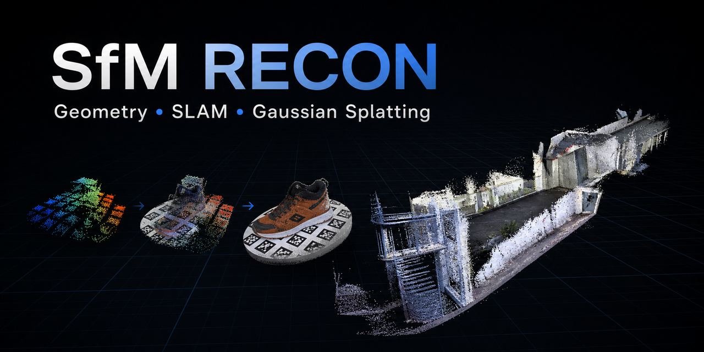
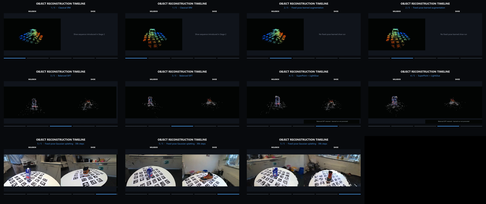
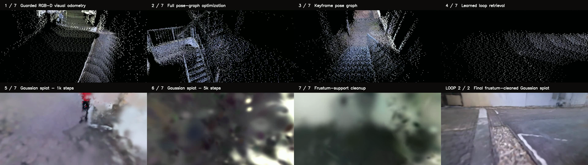
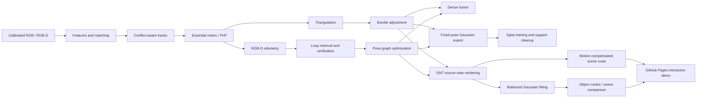

# SfM Recon: Geometry to Gaussian Splatting

[](https://github.com/humma-humma/sfm_recon/actions/workflows/ci.yml)
[](https://www.python.org/)
[](LICENSE)



A from-scratch, calibrated 3D reconstruction system spanning incremental
Structure-from-Motion, learned feature experiments, RGB-D SLAM, pose-graph loop
closure, dense fusion, GNT neural view synthesis, and Gaussian splatting.
Optional C++17, pybind11 and Ceres integrations were also implemented and
benchmarked against Python references; their scope and build instructions are below.

The project emphasizes the complete engineering path: correspondence filtering,
track construction, camera registration, triangulation, nonlinear optimization,
diagnostics, failure analysis, and presentation-quality rendering.

## Interactive demo

**[Explore the interactive demo](https://humma-humma.github.io/sfm_recon/)** - box,
milk, shoe and a full building traversal, with route navigation, timeline seeking,
playback controls and mobile layout. The scene defaults to motion-compensated GNT;
an improved-splat renderer with reliability fallback is available at the same time.

[View all five videos](https://humma-humma.github.io/sfm_recon/portfolio.html) |
[Compare scene renderers and timings](https://humma-humma.github.io/sfm_recon/gnt-scene-15fps-splats.html) |
[Build/deployment guide](web_demo/README.md)

Navigation follows rendered camera routes. The GitHub Actions workflow packages
verified release videos and deploys GitHub Pages; viewing requires no GPU or Docker.
The homepage includes the project overview, full-scene runtime breakdown, PSNR
and SSIM tables, and evaluation-scope notes. The detailed local retrospective and
evidence bundle are excluded from publication.

## Portfolio

| Object reconstruction: milkbox and boot | Full-sequence SLAM: inside view |
|---|---|
| [](assets/portfolio/object_reconstruction_timeline.mp4) | [](assets/portfolio/slam_reconstruction_timeline.mp4) |
| [21-second timeline](assets/portfolio/object_reconstruction_timeline.mp4) | [98-second progression and cleaned-splat loop](assets/portfolio/slam_reconstruction_timeline.mp4) |

The [exterior-view SLAM alternate](assets/portfolio/slam_reconstruction_outside_timeline.mp4)
holds the original classical orbit fixed across every point cloud and Gaussian
checkpoint. Its [contact sheet](assets/portfolio/slam_reconstruction_outside_timeline_contact_sheet.png)
verifies frame-aligned method transitions.

## Demonstrated capabilities

| Demonstration | Input | Progression | Outcome |
|---|---|---|---|
| Supplied-correspondence SfM | Calibrated Stage 1 images | Classical reconstruction -> fixed-pose learned augmentation | More accepted geometry without changing promoted cameras |
| Milkbox reconstruction | Multi-view RGB | Balanced SIFT -> SuperPoint + LightGlue -> 30k splat | Detailed object and surrounding table |
| Boot reconstruction | Multi-view RGB | Balanced SIFT -> fixed-pose 30k splat | Strong object reconstruction at reduced training resolution |
| RGB-D visual odometry | Full indoor/outdoor sequence | Guarded VO -> full pose graph | Complete tracked trajectory with reduced drift |
| Learned loop recovery | RGB-D keyframes | DINOv2 retrieval -> local verification -> keyframe graph | Automatically recovered the promoted loop constraint |
| Neural scene rendering | RGB-D route and source photographs | Adapted GNT -> 15 independent views/s -> motion compensation | Preferred 146.53-second scene traversal at 30fps playback |
| Object presentation | Box, milk and shoe photographs | Adapted GNT views -> balanced Gaussian fitting | Three complete 32-second object routes at 30fps playback |
| Scene splat comparison | GNT anchors and fixed scene geometry | Corrected intermediate splats -> reliability fallback | Faster additional frame generation, with residual indoor artifacts |

## System overview



Core capabilities include:

- SIFT, RootSIFT, AKAZE, and optional SuperPoint + LightGlue matching.
- Essential-matrix initialization and incremental PnP registration.
- Conflict-aware track building with cheirality, reprojection, and angle gates.
- Sparse bundle adjustment with robust SciPy least squares or optional Ceres.
- C++17/pybind11 geometry, analytic Jacobians, pose graphs and threaded support counting.
- RGB-D visual odometry, DINOv2 place retrieval, loop verification, and pose graphs.
- OpenCV dense fusion and metadata-rich PLY export.
- COLMAP-compatible fixed-pose exports for Nerfstudio Splatfacto.
- Support-aware Gaussian cleanup and historical matched portfolio rendering.
- GNT rendering, balanced Gaussian fitting, and motion-compensated scene playback.
- Portable static demo deployment with verified media assets through GitHub Actions.

See [Architecture](docs/ARCHITECTURE.md) for the data model and execution paths.

## Historical reconstruction baselines

Current dataset-specific presets improve on the original results below:

| Current geometry recipe | Measured result | Scope |
|---|---:|---|
| Box, Ceres/native preset | Chamfer `0.427954`; 46 cameras | Exploratory selection on supplied GT |
| Scene, optical flow + native graph | ATE `0.817261`; 4,396 poses | Same verified loop; stable Python independently agrees |
| Native BA / geometry kernels | Component speedups measured | Python reference preserved; timings are not whole-pipeline speedups |

See [parameter screening](docs/HYPERPARAMETER_CHECK.md) and [native follow-up](docs/CPP_FOLLOWUP.md).
Geometry presets and presentation checkpoints are selected separately in
[selected_models.json](configs/splatting/selected_models.json). Lower trajectory
error did not guarantee a better splat render. Scene sensor-depth supervision and
a train-only TSDF baseline are compared in [research results](docs/DEPTH_RESEARCH_RESULTS.md).

The following table retains the original published baselines for context:

| Experiment | Result | Interpretation |
|---|---:|---|
| Stage 1 supplied baseline | Chamfer `0.51242` | Promoted classical camera solution |
| Stage 1 fixed-pose learned augmentation | Chamfer `0.50461`; +1,142 points | Learned geometry helps when camera poses remain fixed |
| Stage 3 guarded raw VO | ATE `3.70073` | Complete but drifting trajectory |
| Stage 3 full pose graph | ATE `3.6164` | Modest global correction |
| Stage 3 keyframe pose graph | ATE `3.030521` | Promoted trajectory |
| Learned automatic loop recovery | ATE held at `3.0305` | Retrieval recovers the useful loop without overstating metric gain |
| Stage 3 Gaussian cleanup | Presentation improvement | Removes unsupported noise; does not change trajectory accuracy |

These are not cherry-picked as a universal learned-over-classical result.
Several learned matching and unrestricted splat-training variants were worse;
those negative findings are documented in [Results](docs/RESULTS.md) and
[Limitations](docs/LIMITATIONS.md).

## Final rendering results

The selected presentation uses balanced Gaussian splats for box, milk and shoe,
and **GNT at 15 independent views/s, motion compensated to 30fps**, for the scene.
The alternate scene renderer uses corrected splat frames between GNT anchors and
falls back to motion interpolation where alignment is unreliable. It is retained
for comparison; motion compensation remains the preferred full-scene result.

| Scene method | Output fps | PSNR (dB, higher is better) | SSIM (higher is better) |
|---|---:|---:|---:|
| GNT + motion compensation | 30 | 35.13 | 0.9321 |
| GNT + corrected intermediate splats | 30 | 32.81 | 0.9154 |
| GNT + corrected splats + reliability fallback | 30 | 34.21 | 0.9291 |

These scores compare the same 89 intermediate frames in a six-second outdoor
segment against independently rendered GNT views. They measure agreement with
GNT, not photographic ground truth or full-route indoor quality. Object scores
on the homepage instead use held-out photographs; the two tables have different
references and must not be compared as one benchmark.

Full-scene GNT renderer calls took **37 h 10 min 42 s** for 2,089 new views, with
109 cached views reused. Splat setup/render/export took **8 min 13 s**, and
correction plus both corrected MP4 encodes took **11 min 31 s**, in addition to
the shared GNT work. The fallback also uses the existing interpolated output.
These costs exclude model training and earlier cached-view rendering. The
[homepage runtime tables](https://humma-humma.github.io/sfm_recon/#results-heading)
explain the overlapping stages and original MP4-ready milestones.

## C++ and Ceres integration

The native C++ sources, Python bindings, opt-in build support, benchmark scripts,
dataset presets and acceptance tests are included in this repository. Python
remains the default. Native selection is explicit; compiled binaries and solver
dependencies are built or installed for the target platform, not committed.

See [build and usage](docs/CPP_INTEGRATION.md),
[C++ benchmark results](docs/CPP_RESULTS.md), [Ceres results](docs/CERES_RESULTS.md),
[native follow-up and distribution](docs/CPP_FOLLOWUP.md), and
[native Gaussian camera-support experiments](docs/SPLATTING_CPP_RESULTS.md).

The implementation includes C++17 geometry and analytic-Jacobian kernels
bound to Python with **pybind11**, analytic bundle-adjustment callbacks for the
existing **SciPy TRF** solver, an optional **Ceres 2.2 / Eigen** bundle-adjustment
solver, an analytic pose-graph backend, and threaded Gaussian camera-support
counting. Native calls release the GIL; Python reference paths remain available.

| Component and input | Python reference | Native | Measured speedup |
|---|---:|---:|---:|
| C++/SciPy bundle adjustment, box | 39.509 s | 8.499 s | 4.65x |
| C++/SciPy bundle adjustment, milk | 16.845 s | 4.553 s | 3.70x |
| Ceres bundle adjustment, box | 39.524 s | 3.327 s | 11.88x |
| Ceres bundle adjustment, milk | 15.898 s | 1.216 s | 13.07x |
| C++ geometry filtering, milk | 0.909 s | 0.231 s | 3.94x |
| C++ camera-support counting, scene (8 threads) | 12.491 s | 0.3116 s | 40.1x |

Timings are local medians of three component calls, excluding setup and external
file IO/evaluation; bundle-adjustment packing and solving are included. These
are separate experiments and configurations, not an end-to-end speedup or an
acceleration of the splat renderer. Ceres and SciPy use different stopping
budgets: 100 iterations versus 20 function evaluations in the original test;
Ceres converged in 12 recorded iterations.

Accuracy was checked alongside runtime. Camera-support counts and geometry-filter
IDs matched their references on the tested inputs. Ceres improved box geometry
in the original comparison, but milk's nearest-mesh-vertex distance proxy worsened
by 4.77% despite slightly better cameras. The initial native pose graph also
regressed trajectory ATE on the historical input; later optical-flow/native
recipes were evaluated separately. Native selection therefore remains explicit
and dataset-specific. GNT inference optimization uses PyTorch compiler fusion,
not a claimed custom C++ rewrite of the transformer.

## Quick start

```bash
git clone https://github.com/humma-humma/sfm_recon.git
cd sfm_recon
python -m venv .venv
```

Activate the environment, then install the core package and test tooling:

```bash
python -m pip install --upgrade pip
python -m pip install -e ".[dev,evaluation,visualization]"
python -m pytest -q -p no:cacheprovider
```

Optional components:

```bash
python -m pip install -e ".[open3d]"   # interactive point-cloud rendering
python -m pip install -e ".[learned]"  # PyTorch/Kornia learned frontends
```

Confirm the primary entry point:

```bash
sfm-reconstruct --help
```

## Run a reconstruction

Stage 2 image-based reconstruction:

```bash
sfm-reconstruct \
  --stage 2 \
  --dataset /path/to/stage2/milk \
  --output-dir outputs/milk \
  --feature-mode sift \
  --max-features 2500 \
  --mask-apriltags \
  --min-track-observations 3 \
  --bundle-adjustment-max-nfev 20
```

The output contains:

```text
estimated_camera_parameters.json
estimated_points.ply
estimated_points_rich.ply
summary.json
```

Stage 3 RGB-D smoke run:

```bash
sfm-stage3-setup \
  --dataset /path/to/stage3 \
  --output-dir outputs/stage3_smoke \
  --max-frames 500 \
  --run-rgbd-odometry
```

Datasets are intentionally not redistributed. See [Datasets](docs/DATASETS.md)
for required layouts and [Reproduction](docs/REPRODUCTION.md) for the full
classical, learned, SLAM, and Gaussian workflows.

## Repository map

```text
src/sfm_reconstruction/
  geometry.py                 projection, pose, and triangulation primitives
  matching.py                 classical/learned matching and pair filtering
  tracks.py                   multi-view track construction
  reconstruction.py           incremental SfM orchestration
  bundle_adjustment.py        Python, C++/SciPy and Ceres BA
  native_backend.py           pybind11 loading, array packing and solver dispatch
  dense_fusion.py             stereo-based dense fusion
  stage3.py                   RGB-D odometry and trajectory processing
  pose_graph.py               loop constraints and graph optimization
  stage3_*gaussian*.py        splat export, diagnostics, seeds, and cleanup
  stage3_portfolio_video.py   frame-synchronized portfolio rendering
native/                       C++17 analytic kernels, Ceres BA and CMake
configs/                      saved dataset and splat-selection recipes
tests/                        CPU tests, optional native acceptance and rendering helpers
docs/                         architecture, results, data, and reproduction
assets/portfolio/             historical curated presentation videos
web_demo/                     current interactive demo, tables, and public metrics
scripts/build_demo_site.py    portable site packaging and media integrity checks
.github/workflows/demo-pages.yml  GitHub Pages deployment
```

## Documentation

- [Complete pipeline, stage map and external setup requirements](docs/PIPELINE.md)

Optional native splatting experiments and measured results: [camera support and depth cleanup](docs/SPLATTING_CPP_RESULTS.md).

Selected-preset exports and completed GPU evaluation: [cleanup evaluation and splat refresh](docs/SPLAT_REFRESH.md).

Interactive demo: [Open the demo](https://humma-humma.github.io/sfm_recon/) | [viewing and deployment guide](web_demo/README.md).
Research adaptation and controlled results: [measured-depth supervision and RGB-D surface fusion](docs/DEPTH_RESEARCH_RESULTS.md).
Scene failure analysis: [coverage, alignment, train/held-out and depth diagnosis](docs/SCENE_DIAGNOSIS.md).
Local release status, verification, and remaining limitations: [release notes](docs/RELEASE_STATUS.md).


- [Architecture and data flow](docs/ARCHITECTURE.md)
- [Verified experiments and provenance](docs/RESULTS.md)
- [Reproduction guide](docs/REPRODUCTION.md)
- [Dataset layouts](docs/DATASETS.md)
- [Gaussian splatting workflow](docs/GAUSSIAN_SPLATTING.md)
- [Learned matching experiments](docs/LEARNING_BASED_AUGMENTATION.md)
- [Limitations and next steps](docs/LIMITATIONS.md)
- [Optional C++ backends and benchmarks](docs/CPP_INTEGRATION.md)
- [Hyperparameter checks across box, boot, milk and scene](docs/HYPERPARAMETER_CHECK.md)
- [Actual GNT and 2DGS lightweight trials](docs/LIGHTWEIGHT_METHODS.md)
- [Local GNT inference tuning and scene adaptation](docs/GNT_TUNING.md)
- [Balanced whole-scene GNT experiment](docs/GNT_BALANCED.md)
- [Matched GNT patch and structural-loss experiment](docs/GNT_DETAIL.md)
- [Full-route native GNT traversal video](docs/GNT_TRAVERSAL.md)
- [GNT object adaptation, motion blending and runtime trials](docs/GNT_FINALIZATION.md)
- [C++ follow-up, native wheels and saved presets](docs/CPP_FOLLOWUP.md)
- [Historical development log](docs/DEVELOPMENT_LOG.md)

## Testing and reproducibility

The CPU test suite covers geometry, matching, tracks, reconstruction, bundle
adjustment interfaces, trajectory IO/evaluation, pose graphs, splat export and
cleanup, and synchronized video-path mathematics. GPU training is deliberately
excluded from CI.

```bash
python -m pytest -q -p no:cacheprovider
python -m build
```

GitHub Actions runs the test suite on Python 3.10 and 3.11 and builds the wheel
on every push and pull request. The separate native-wheel workflow builds and
tests repaired Ceres-enabled wheels on Linux, Windows and macOS for Python 3.10
and 3.11; artifacts are uploaded to Actions, not published to PyPI.

## Scope and limitations

- The datasets and trained Gaussian checkpoints are not redistributed.
- Learned matching is an optional augmentation, not a guaranteed improvement.
- Stage 3 remains weak around stairs and sparsely observed surroundings.
- Gaussian cleanup improves presentation rather than pose metrics.
- GNT frame generation is offline; 30fps playback does not mean 30fps GNT rendering.
- Scene interpolation and corrected splats retain occlusion, motion and indoor artifacts.
- Native benchmark gains apply to named components, not the complete pipeline.

See [Limitations](docs/LIMITATIONS.md) for the complete discussion.

## License and citation

Released under the [MIT License](LICENSE). If this repository supports your
work, cite it using [CITATION.cff](CITATION.cff).
